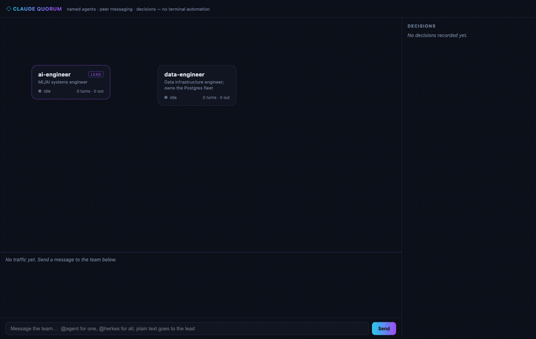
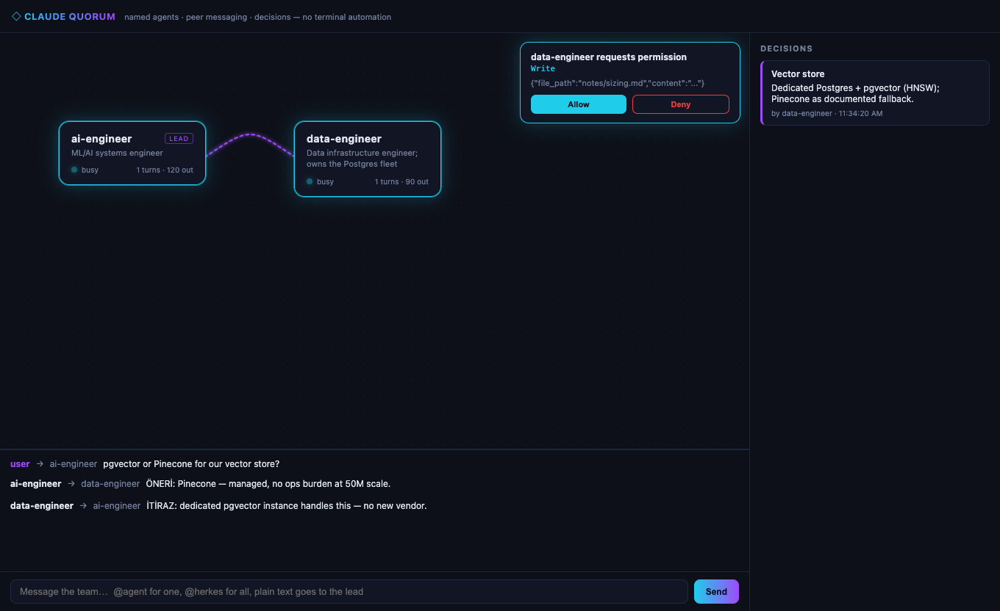
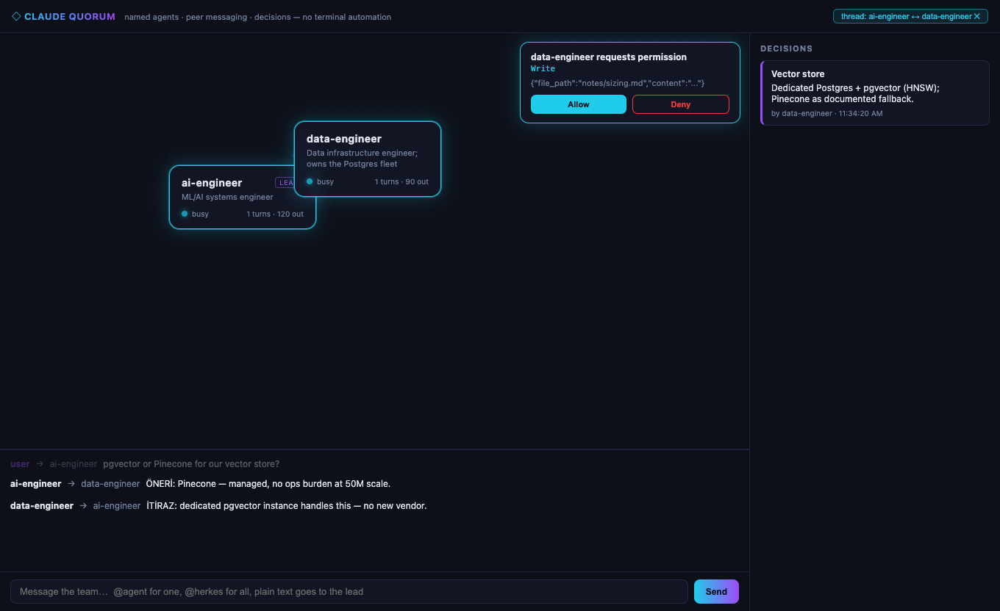

# Quorum

**Run your Claude Code agents as a team — named agents that talk to each other, debate, and decide, each one an independent `claude` session, visualized live.**

> Quorum is an independent open-source project built on the official Claude Code CLI and Agent SDK. It is not affiliated with or endorsed by Anthropic; "Claude" is a trademark of Anthropic, PBC.



> *Above (real ~10s capture, not scripted): two live `claude` sessions exchange PROPOSE/OBJECT/ACCEPT messages in the meeting room, reach a decision — "pgvector over Pinecone" — and record it via `record_decision`. (The capture shows the since-removed decisions side panel; decisions now persist to disk only.)*

> Status: **P0–P4 core working, live-verified.** Electron app runs; a desktop packaging/onboarding pass is the remaining work before a tagged release.

## What

Today's Claude Code subagents are fire-and-forget child tasks: they can't talk to each other, and you can't talk to them. Quorum flips the model — every agent is a **full, persistent Claude Code session** (driven through the Agent SDK), and a desktop app wires them together:

- **Talk to the agents directly** — type in the meeting room. Plain text goes to the whole team, `@agent` to one, canvas selection to a chosen group. (The Team Lead is reached from Claude Code, not from the composer.)
- **Pick agents to work as a group** — lasso-select 2+ blocks on the canvas; your message goes to exactly them as a coordinated group task ("you two, talk it over").
- **Mode-aware delivery** — who answers you follows how you addressed the team. Plain text → the lead synthesizes one voice (teammates' user-bound messages route through the lead). Address one agent → that agent answers you itself. Group task → **each participant answers once**, from its own specialty, with a per-participant reply budget enforced by the bus (no closing chatter).
- **ESC to interrupt** — aborts every busy agent's in-flight turn via the SDK's documented `interrupt()` (the panic button when something runs long); queued messages survive, and the stopped agent isn't nudged back to life.
- **Tune each agent** — double-click a block to switch its model (haiku / sonnet / opus / fable) and its permission mode (read-only / ask-to-write / auto). A model change restarts the session via `--resume`, keeping history.
- **Agent marketplace** — 379 ready agents (wshobson + automotive + [anthropics/financial-services](https://github.com/anthropics/financial-services)) searchable across all fields; "add to team" spawns a live session for the ones you pick.
- **Agents message each other** — ask questions, split work, negotiate via an MCP `send_message` tool.
- **Agents make decisions** — a PROPOSE / OBJECT / ACCEPT protocol, with outcomes persisted to disk via `record_decision` (`decisions.jsonl` + rendered `decisions.md`).
- **Agents share a task board** — `add_task` / `claim_task` / `complete_task`; atomic claims prevent two agents doing the same work.
- **The team remembers** — decisions and the board persist in `.quorum/` and prime every fresh session: a compact *Team memory* digest (recent decisions + open work) is injected at spawn, and a `list_decisions` tool serves the details. Restarting the app doesn't lobotomize the team.
- **Live canvas** — sessions as blocks (busy blocks glow), message traffic as animated arrows, permission requests as approval cards, draggable + resettable layout, click a message to focus its thread.

### Talking to the team (the three modes)

What you type in the meeting room is routed by the bus, and **who may answer you follows how you addressed the team** — enforced in the bus, not in prompts:

| Mode | You type / do | Goes to | Who answers you |
|---|---|---|---|
| **Whole team** (default) | plain text (no `@`) | **all agents**, as a coordinated group task — the composer talks to agents only; the Team Lead is reached from Claude Code | each participant, exactly once |
| **Single target** | `@agent-name …` or select one block | just that agent | that agent, directly — it owns the user channel until your next message; anyone else is bounced |
| **Group task** | select 2+ blocks, or type `@everyone` | exactly those agents (or all), as a coordinated group task | **each participant, exactly once** — its own specialty slice, after the group has consulted and converged; the per-participant reply budget is enforced by the bus |
| **In-app lead** (legacy) | plain text, only when the team.json declares a `lead` agent (example team, scripts) | that lead, with a `[LEAD BRIEF]` coordination frame | only the lead, ONE combined reply; teammates' user-bound messages reroute through it |

The Team Lead block on the canvas is not selectable (lasso and clicks pick agents only) and `@everyone` never includes it — it is not an agent session.

A group message isn't raw: it's wrapped as `[TEAM TASK — participants: …]` with a `[delivery]` instruction, and every agent's system prompt has a **Group tasks** section telling them to contribute from their own expertise, split work on the shared board (`add_task`/`claim_task` — no duplicated effort), resolve disagreements with the decision protocol *before* anyone replies, and never send closing chatter ("all done") to you — past-budget messages bounce back to the sender.

Team size is capped at **5 agents** (`MAX_AGENTS`, enforced by the bus and the marketplace add path).

### Drive the team from Claude Code (the bridge)

Quorum hosts a localhost MCP endpoint (`http://127.0.0.1:8484/mcp`, port via `QUORUM_BRIDGE_PORT`). Register it once:

```bash
claude mcp add --scope user --transport http quorum http://127.0.0.1:8484/mcp
```

Now any Claude Code session (VS Code extension, terminal) acts as the team's **lead**: `ask(text, selected?)` routes exactly like the meeting-room composer (`@name` / `@everyone` / selected group), `replies(wait_seconds)` long-polls the answers, `roster()` shows live state. The rich conversation — markdown, tables, plans — happens in your editor; the Quorum window becomes the live monitor for agent-to-agent traffic. Marketplace additions default to **haiku** for speed (upgrade per-agent via the inspector).

**Live lead glow (optional):** the Team Lead block has two glow levels — a bright pulse ("driving the team…") whenever bridge traffic flows (built-in, first-party), and a soft glow ("working…") whenever your Claude Code session is active in the open project. The soft level needs three user-level Claude Code hooks (UserPromptSubmit / PostToolUse / Stop) that forward their stdin JSON to `http://127.0.0.1:8484/lead-activity`; only sessions whose cwd is inside the open project count, claims expire after 2 minutes without a ping (so a crashed session can't leave the light on), and the pings are fire-and-forget (`async`, cosmetic only — nothing depends on them).

## Why it's different

- **No API costs.** Everything runs on your existing Claude subscription through the `claude` CLI. Not a single Anthropic API request.
- **Built only on documented interfaces.** No terminal automation, no transcript scraping, no name-fingerprint matching. Sessions run in the CLI's official programmatic mode (via the Agent SDK, which wraps stream-json in/out); identity comes from the stream's own `session_id`; persistence via `--resume`; tools via MCP; permissions via the SDK's `canUseTool` callback. **State comes from real processes, not agent self-reports** — the "is it actually running?" class of bugs is structurally impossible.
- **The app never proxies the LLM.** Quorum transports and visualizes messages; it never generates content or makes model calls.
- **Swappable message backend.** The durable investment is session management + visualization; the transport layer is deliberately thin, so it can be swapped if Anthropic's experimental agent-teams feature ever goes GA.

### vs. Claude Code's built-in agent teams

Anthropic ships an experimental [agent teams](https://code.claude.com/docs/en/agent-teams) feature (`CLAUDE_CODE_EXPERIMENTAL_AGENT_TEAMS=1`) that also gives named sessions a shared task list and inter-agent messaging. Quorum deliberately reimplements that core on documented interfaces and adds what the built-in doesn't have: a **live GUI canvas** (the built-in is terminal-only; its split-pane view needs tmux/iTerm2 and doesn't work in VS Code's terminal, Windows Terminal, or Ghostty), a **PROPOSE/OBJECT/ACCEPT decision protocol with persisted decisions**, **per-agent model + permission switching at runtime**, and an **agent marketplace**. Same subscription-only cost model, no API.

## Screens

| Live message traffic | Thread focus |
|---|---|
|  |  |

## Architecture

```
┌────────────────── Quorum (Electron main) ──────────────────┐
│  Session Manager          Message Bus         Decision +   │
│  one Agent SDK session    queue + routing     Task stores  │
│  per agent block          + turn budget       (persisted)  │
│  (query() / canUseTool)        │                           │
└───────┬──────────┬─────────────┼───────────────────────────┘
        │          │   in-process MCP: send_message / list_agents /
   ┌────▼───┐ ┌────▼───┐  record_decision / add_task / claim_task /
   │agent A │ │agent B │  complete_task
   └────▲───┘ └────▲───┘
        └── user talks to the team via the meeting-room UI ──┘
```

Each session runs through the Agent SDK's `query()` (the documented wrapper over stream-json), with permissions handled by its `canUseTool` callback — no raw terminal, no PTY. A `send_message` call lands directly on the bus (the MCP server runs in-process). A busy session's messages queue until its turn ends — turn lifecycle is read from the stream's own events, never inferred. Sender identity comes from the per-session closure, never from message content.

## Roadmap

| Phase | Scope | Status |
|---|---|---|
| **P0** | Core proof: two `claude --agent` sessions + `send_message` + a message round-trip | ✅ verified |
| **P1** | Reliable bus: busy tracking, queueing, turn budget, routing | ✅ verified |
| **P2** | Decision layer: team protocol, `record_decision`, persistent decisions | ✅ verified |
| **P3** | Canvas: blocks, message arrows, decisions panel, meeting room, permission cards, drag + threads | ✅ live-verified |
| **P4** | Patterns: shared task board, coordinator/worker | ✅ live-verified |
| **P5** | Marketplace (379 agents across 3 sources), per-agent model/permission, canvas multi-select, group broadcast, clear layout/decisions | ✅ verified (UI no-quota + live) |
| — | Voting protocol, per-agent chat windows, long-run reliability at scale, desktop packaging, tagged release | ⏳ next |

## Running it (dev)

Requirements: Node ≥ 22, and the `claude` CLI on your PATH signed into a Pro/Max plan.

```bash
npm install
npm run build            # bundles main (CJS) + renderer (Vite)
npm start                # launches the Electron app with an EMPTY team
npm test                 # unit tests (bus, decisions, task board) — no quota used
npm run package:mac      # packages release/Quorum-<version>-arm64.dmg (unsigned)
```

The packaged app stores its state (decisions, task board, layout) under `~/Library/Application Support/Quorum`.

**One CLAUDE.md instructs the whole team.** Opening a project that has no `CLAUDE.md` scaffolds a Quorum-flavored template once (an existing file is never touched). The lead reads it natively, like any Claude Code session; Quorum injects the same file into every agent's system prompt at spawn — project conventions and behavioral guidelines reach the entire team from a single file. Edits apply to newly spawned/restarted agents.

**Quorum works per project, like an editor.** A fresh launch shows a brand splash and a **welcome screen** — open a folder or click one of your recent projects. In the app, the **▸ project** badge in the header switches folders — the agents run with that folder as their working directory, and everything you build (team composition, per-agent model/permission settings, decisions, task board, canvas layout) persists under `<project>/.quorum/`. Reopening the project restores the same team; the app remembers your last project across launches. Add `.quorum/` to the project's `.gitignore` if you don't want that state in the repo.

A fresh project starts with **zero agents** — build the team from the marketplace (max 5). To boot a predefined team, put a `team.json` in the project root or set `QUORUM_PROJECT` (see [example/team.json](example/team.json); the verify/demo scripts use it). To exercise the UI without spawning `claude` sessions (no quota), set `QUORUM_NO_SESSIONS=1`.

## Design doc

The full brief (architecture, decision protocol, no-backdoors rule, market survey) lives in [CLAUDE-QUORUM-BRIEF.md](CLAUDE-QUORUM-BRIEF.md) (Turkish). Interactive architecture diagram: [quorum-mimari.html](quorum-mimari.html). Per-phase verification findings are in `p0/`–`p4/` `BULGULAR.md` files.
