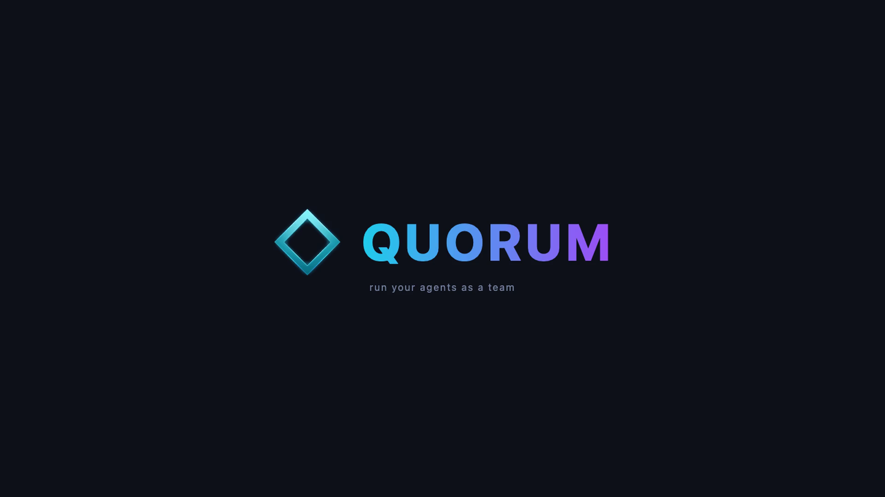
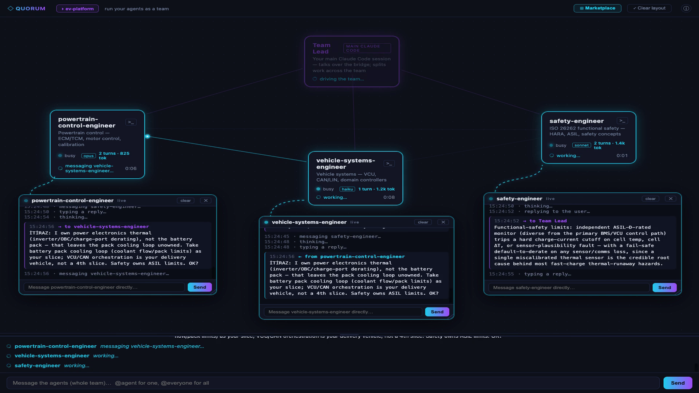
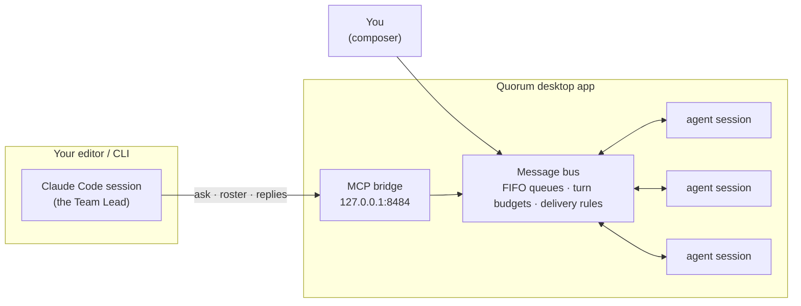

<p align="center">
  
</p>

<p align="center">
  <b>Run your Claude Code agents as a real team.</b><br/>
  Named specialist agents that message each other, debate, converge — and report back to you —<br/>
  each one a full Claude Code session, visualized live on a desktop canvas.
</p>

<p align="center">
  <a href="LICENSE"></a>
  
  
  
</p>

---


> *Real capture, not scripted: the Team Lead (a normal Claude Code session in the editor) dispatches one task to three automotive agents. They negotiate the split among themselves — you can watch each agent's live terminal — then each reports its own slice back.*

## No API costs. Really.

Quorum **does not use the Anthropic API and never asks for an API key.** Every agent is a real `claude` session started through the official [Claude Agent SDK](https://docs.claude.com/en/api/agent-sdk/overview), authenticated by the Claude Code login you already have. If you have a Claude subscription that runs Claude Code, you can run a whole team of agents at no extra cost beyond your plan's usage limits.

## Why

Claude Code subagents are fire-and-forget child tasks: they can't talk to each other, and you can't talk to them while they work. Quorum flips the model:

- Every agent is a **persistent, named Claude Code session** with its own specialty, model, and permission mode.
- Agents **message each other** — ask questions, split work, object, converge — over a documented MCP tool surface.
- **Your own editor session becomes the Team Lead.** Quorum exposes a local MCP bridge; the Claude Code session you already work in connects to it and orchestrates the team — decomposes work, collects replies, synthesizes. The intelligence coordinating your agents is the same one you code with.
- Everything is **visualized live**: message comets fly between agent blocks, violet when the Team Lead speaks, cyan for everything else.

## Highlights

| | |
|---|---|
| 🧠 **External Team Lead** | Your editor's Claude Code session drives the team over a local MCP bridge (`ask` / `roster` / `replies`). The lead's block glows when it's working — brighter when it's actively driving the team. |
| 🖥️ **Per-agent terminals** | Pop out a live terminal for any agent — its full traffic stream, tethered to its block with a curved connector that glows while the agent works. Each terminal has its own composer for one-on-one conversation. |
| 🎯 **Mode-aware delivery** | How you address the team decides who answers. Plain text → group task for everyone. `@agent` → that agent answers you directly. Select several blocks → a coordinated group task where **each participant answers exactly once**, enforced by the bus, not by prompt hopes. |
| 🛒 **377-agent marketplace** | Ready-made specialist agents (see [credits](#agent-marketplace--credits)) searchable across every field; "add to team" spawns a live session. Teams cap at 5 agents. |
| 📝 **Team memory** | Agents record decisions (`PROPOSE / OBJECT / ACCEPT`) to `.quorum/decisions.jsonl`; new sessions spawn with a digest of the last decisions and open tasks, and can query the rest on demand. |
| 🗂️ **Task board** | `add_task` / `claim_task` / `complete_task` with atomic claims — two agents can't grab the same work. |
| ⏹️ **ESC interrupts** | One key aborts every busy agent's in-flight turn via the SDK's documented `interrupt()`. Queued messages survive. |
| 🎛️ **Per-agent tuning** | Double-click a block: switch model (haiku / sonnet / opus / …) and permission mode (read-only / ask-to-write / auto). Model changes restart via `--resume`, keeping history. |
| 💾 **Per-project persistence** | Open Quorum on any project folder; its team, layout, decisions, and tasks live in that project's `.quorum/`. Reopen and continue where you left off. |
| 🏷️ **Truthful activity labels** | "messaging safety-engineer…", "replying to the user…", "reporting to the lead…" come from actual delivery outcomes on the bus — never guessed from tool intent. |

<p align="center">
  
  <br/><i>Agents negotiate ownership among themselves (OBJECT/ACCEPT), each in its own live terminal — running haiku, sonnet, and opus side by side.</i>
</p>

## How it works



Quorum itself **never calls a model**. It transports and visualizes messages; all intelligence lives in your Claude sessions. The rules that matter — reply budgets, queuing, delivery guarantees — are enforced in the application layer, not written into prompts and hoped for.

## Quickstart

**Prerequisites:** macOS (developed there; `npm start` is portable), Node 24+, and [Claude Code](https://claude.com/claude-code) installed and logged in (`claude` on your PATH).

```bash
git clone https://github.com/birol91/quorum-agents.git
cd quorum-agents
npm install
npm start
```

1. Pick a project folder from the welcome screen (or reopen a recent one).
2. Open the **Marketplace** and add up to 5 agents — or create your own with a name, description, and persona.
3. Type in the composer. Plain text tasks the whole team; `@agent-name` targets one; select several blocks to task exactly that group.

**Connect your Team Lead** (optional, and the best part). In the project where you run Claude Code:

```bash
claude mcp add --transport http quorum http://127.0.0.1:8484/mcp
```

Then just tell your editor session things like *"split this refactor across the team and collect their findings"* — it will use the bridge's `ask` / `roster` / `replies` tools, and you'll watch the whole conversation play out on the canvas.

## Addressing modes

| You write | Who gets it | Who answers you |
|---|---|---|
| plain text | every agent, as a group task | each agent, exactly once, from its own specialty |
| `@one-agent …` | that agent | that agent, directly |
| select 2+ blocks, then send | exactly those agents | each selected agent, exactly once |
| via Team Lead (bridge) | whoever the lead decides | the lead, with a synthesis |

## Agent marketplace — credits

The 377-agent catalog bundled in `.claude/agents/` is generated from three excellent MIT-licensed collections. All credit to their authors — Quorum only repackages the prompts with marketplace metadata:

| Source | Agents | What |
|---|---|---|
| [wshobson/agents](https://github.com/wshobson/agents) | 126 | The classic Claude Code subagent collection — engineering, cloud, data, security, SEO, business |
| [im-hashim/automotive-claude-code-agents](https://github.com/im-hashim/automotive-claude-code-agents) | 241 | Deep automotive software engineering — AUTOSAR, ISO 26262, ADAS, EV systems, cybersecurity |
| [anthropics/financial-services](https://github.com/anthropics/financial-services) | 10 | Anthropic's financial-services agent examples |

Regenerate or extend the catalog with `scripts/import-agents.mjs`.

## Design principles

1. **Documented interfaces only.** Agents run through the official Agent SDK; the lead connects over MCP; model switches use `--resume`. No PTY automation, no transcript scraping, no state inference — if the answer to *"how do we know this?"* would be "we guessed from a side channel," the design is rejected.
2. **Mechanism over prompt.** Turn budgets, reply grants, queueing, and delivery guarantees live in the app layer where they can't be talked out of.
3. **The app is not an AI.** Quorum produces no content and proxies no model calls. It is plumbing and glass.

## Development

```bash
npm test              # unit tests (bus mechanics, decisions, tasks, team)
npm run typecheck     # strict TypeScript
npm run dev           # vite + electron with hot renderer
npm run package:mac   # build a DMG (electron-builder, arm64)
```

## License

[MIT](LICENSE) © birol91

> Quorum is an independent open-source project built on the official Claude Code CLI and Agent SDK. It is not affiliated with or endorsed by Anthropic; "Claude" is a trademark of Anthropic, PBC. Bundled marketplace agents remain under their original MIT licenses — see [credits](#agent-marketplace--credits).
